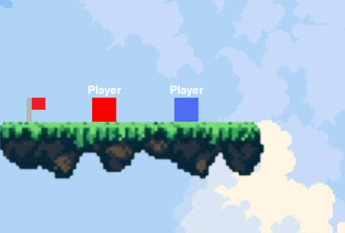
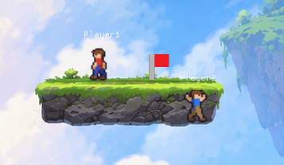

# pyCTF - Rust/Macroquad Port (pyrust)

**pyCTF** is the original Python/pygame version of the Capture the Flag game.
**pyrust** is the new Rust/Macroquad port of this version. 

## Gameplay

- Two players (Red vs Blue) compete to capture the flag
- The attacker tries to grab the opponent's flag and return it to their base
- The defender tries to stop the attacker or catch them
- Rounds last 120 seconds; scoring is based on flag captures, defender catches, and void kills
- Players can customize their names (up to 12 characters)

## Controls

### Player 1 (Red)
- **Move**: A / D
- **Jump**: W
- **Fall/Hang**: S
- **Dash left**: Q
- **Dash right**: E

### Player 2 (Blue)
- **Move**: J / L
- **Jump**: I
- **Fall/Hang**: K
- **Dash left**: U
- **Dash right**: O

### General
- **Enter/Space**: Start game (from lobby)
- **Tab**: Switch between name input fields
- **F11**: Toggle fullscreen (Macroquad default)
- **9**: Toggle hitbox display (debug)

## Installation

### Prerequisites
- Rust and Cargo installed (via `rustup`)
- Macroquad game framework

### Building
```bash
git clone <https://github.com/kampans/pyctf-rust>
cd pyctf-rust
cargo run
```

The game will launch in a 1600x900 window.

## Project Structure

```
pyctf-rust/
├── assets/
│   ├── pictures/
│   │   ├── pyctf.png          # Original Python version screenshot
│   │   └── pyrust.png         # New Rust version screenshot
│   ├── background.png         # Game background
│   ├── blueflag.png           # Blue team flag
│   ├── gamemusic.ogg          # Background music
│   ├── jump.ogg               # Jump sound effect
│   ├── player_blue.png        # Blue player sprite
│   ├── player_red.png         # Red player sprite
│   ├── redflag.png            # Red team flag
│   ├── Untitled.png           # Placeholder texture
│   └── woosh.ogg              # Dash/swoosh sound effect
├── src/
│   ├── main.rs                # Entry point - window config, game state, lobby
│   └── game.rs                # Game entities, physics, collision, scoring
├── Cargo.toml                 # Rust package configuration
└── .gitignore
```

### Screenshots
- **pyctf.png**: Screenshot of the original Python/pygame version
- **pyrust.png**: Screenshot of this Rust/Macroquad port




## Game Mechanics

- **Physics**: Tuned for ~60 FPS with acceleration, friction, and gravity
- **Platforming**: Players can stand on platforms and fall through them
- **Flag carrying**: When a player holds the flag, the defender can catch them
- **Scoring**:
  - 10 points for capturing the flag
  - 10 points for defender catching the attacker
  - 5 points for opponent falling into the void
- **Round timer**: 120 seconds per round; roles swap when time runs out
- **Spawn protection**: Players spawn with a flash effect and invulnerability

## Development

Built with:
- **Macroquad 0.4** - Rust game library
- **Rand** - Random number generation

The game aims to faithfully port the original pyCTF gameplay experience to Rust while taking advantage of Macroquad's cross-platform capabilities.

## License

License on this code is yet to be decided.